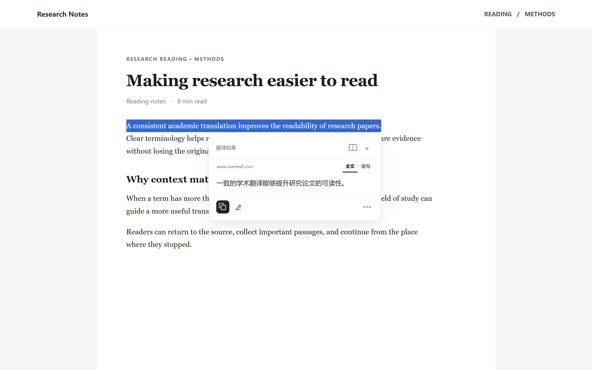
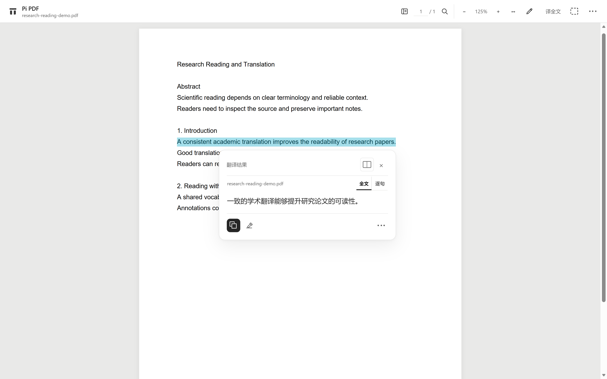
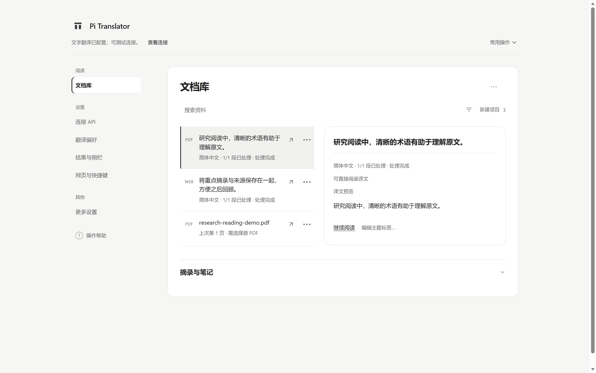
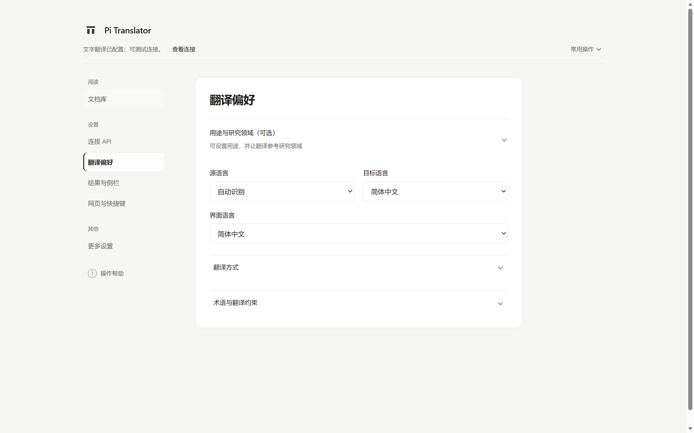

# Pi Translator（PI划词翻译器）

在网页、Overleaf 和 PDF 中阅读外文：划词查看译文，保留原文、公式与上下文，也能把有价值的段落、笔记和术语整理起来，方便下次继续阅读。

[安装 Edge 扩展](https://microsoftedge.microsoft.com/addons/detail/edfkcddhenkhdkedhnmcebmmfacabcjf) · [快速上手](#快速上手) · [功能介绍](#功能介绍) · [隐私与数据](#隐私与数据) · [反馈问题](https://github.com/LittlePyx/Pi-translator/issues)



> 本页截图来自扩展的实际界面；网页、PDF、资料和译文均为隔离环境中的演示数据，翻译响应由模拟接口提供。

## 适合怎样使用？

- **日常浏览**：在外文网页中选中不理解的文字，快速查看译文；也可以主动翻译网页正文，进行双语对照。
- **科研阅读**：在 Pi PDF 阅读器中阅读论文、划词、查看全文译文，并在笔记、术语和原文之间往返。
- **语言学习**：按需切换目标语言、查看逐句对照，保存想回顾的内容，并在设置中调整翻译偏好。

Pi Translator 使用你选择和配置的翻译服务。服务商、模型能力、使用费用和数据处理规则会影响实际体验。

## 快速上手

### 1. 安装并连接翻译服务

1. 在 [Microsoft Edge 扩展商店](https://microsoftedge.microsoft.com/addons/detail/edfkcddhenkhdkedhnmcebmmfacabcjf)安装 Pi Translator，点击浏览器工具栏中的扩展图标。
2. 在首次设置中按提示选择用途、翻译服务商并填写自己的 API Key；按浏览器提示授予所选接口所需的访问权限。可读取模型列表，也可手动填写模型 ID。
3. 先完成**文字翻译**即可开始使用。公式、图片和截图翻译需要时，再配置可处理图像的模型；这些增强设置可跳过。
4. 主动测试连接会发送示例请求，可能产生费用。普通保存设置不会自动测试模型。

扩展提供 DeepSeek、阿里云百炼 / Qwen、OpenAI、Anthropic、Google Gemini、OpenRouter 和本机 Ollama 等预设，也支持填写自定义兼容接口。预设和模型列表并不保证你的账号可使用所有模型，具体以服务商提供的能力和权限为准。

### 2. 翻译网页

在普通网页选中文字，点击出现的小翻译按钮；也可使用右键菜单或快捷键 `Alt+Shift+T`。首次在普通网页使用持续划词功能时，按提示决定是否授予网站访问权限。图标会根据选区和目标语言等条件决定是否显示，用户也可以暂停当前网站的自动划词。

想连续阅读时，可以使用页面侧栏或 Edge 浏览器侧栏；想阅读双语全文时，从扩展面板主动启动网页正文翻译。浏览器内部页面、扩展商店及其他禁止扩展访问的页面不支持网页划词。

### 3. 在 Pi 阅读器中打开 PDF

从扩展面板选择 **打开 PDF 阅读器**，然后选择本地文件；也可以从支持的在线 PDF 或 Edge 原生 PDF 侧栏进入。浏览器读取本地文件时，可能需要在扩展详情中允许访问文件 URL；也可以在 Pi 阅读器中手动选择文件。



有文字层的 PDF 可以直接划词。使用 **译全文** 时，先在本机预览可识别内容，再由你决定是否开始、选择范围并管理翻译任务。扫描件和复杂公式的识别能力取决于配置的模型与功能入口，结果应结合原文核对。

## 功能介绍

### 划词、双语与侧栏

- 在网页、Overleaf 和 Pi PDF 中划选文字，查看原文与译文；支持逐句对照、复制和手动修正。
- 页面侧栏适合连续划词；浏览器侧栏可在 Edge 原生 PDF 等场景使用，并提供进入 Pi 阅读器的入口。
- 网页正文翻译在原文附近展示译文；可按需开始、暂停、继续或调整显示方式。
- 网页或 PDF 的区域框选适合图像、图表和复杂公式；发送前需要确认选定区域，并配置兼容的视觉模型。

### 阅读、笔记与资料库



在 Pi PDF 中搜索、标记、记笔记并返回出处；已保存的网页和 PDF 内容可在文档库中搜索、筛选和继续阅读。可用项目、标签组织资料，也可在阅读回顾中查看已有标记和最近修改的笔记。

本篇笔记小结会先展示可选范围，只有主动生成时才使用当前配置的文字接口。小结中的出处入口帮助你回到记录位置；生成内容仍需结合原文核对。

原 PDF 默认不会因为阅读而复制到资料库。你可以选择在本机保留原文件副本；导出备份时，也可以选择是否包含这些副本。备份与恢复的范围和限制以界面预览及[隐私政策](PRIVACY.md)为准。

### 用途、研究领域与术语



在 **翻译偏好** 中选择用途、语言和翻译方式；科研用户还可以填写研究领域。研究领域可在本机辅助推荐已有术语方案，只有确认后才会应用；也可选择让后续翻译参考该领域。启用该选项时，领域名称会随相关翻译请求发送给所选服务商。

术语方案适合维护某个领域常用的译法；**本文确认术语**用于当前文档并优先于通用约定。你可以导入、编辑和确认词条，人工修正与旧译文不会因选择方案而自动重写。

### 公式、图像与扫描件

文字翻译与图像增强可以使用不同配置。网页截图翻译、PDF 区域翻译及部分公式识别需要支持图像输入的模型；扫描页识别还有独立的 OCR 配置要求。设置页面会区分“已填写”和“已测试”，避免把模型列表当作能力验证。

公式、表格和复杂版面可能出现识别或翻译误差；请对照原文检查。已知 PDF 问题、验证范围与未解决事项记录在 [PDF 翻译问题台账](docs/pdf-translation-issues.md)。

## 隐私与数据

- 已保存的资料、笔记、阅读位置和术语主要保存在浏览器本机，可通过资料库管理和备份。
- 用户触发翻译、生成笔记小结或确认图像识别时，相应文本、选中的笔记或图像区域会发送至所配置的服务商；具体范围取决于所用功能。
- API Key 用于访问你配置的服务；请不要将真实 Key 提交到仓库、写入问题反馈或放在截图中。
- 原 PDF 副本是否保留、是否随备份导出由你选择。完整权限、数据保存范围和备份限制见 [隐私政策](PRIVACY.md)。

## 常见问题

**划词后没有出现按钮？** 检查是否已授权当前网站、是否暂停了该网站的自动划词，以及选区是否需要翻译。浏览器内部页面、扩展商店等受限页面无法注入扩展；也可尝试右键菜单或快捷键。

**已有文字 API，还要配置图像模型吗？** 普通文字翻译不需要。只有使用图片、截图、部分公式增强等功能时才需要兼容的视觉模型；扫描页 OCR 另有要求。

**设置完成后会自动翻译吗？** 普通保存设置不会自动测试模型。遇到中断任务时，按页面提示返回并确认相应操作；测试连接或主动翻译可能产生服务商费用。

**翻译和笔记可以备份吗？** 可以在文档库中预览、导出和导入支持的资料。API Key 不包含在安全配置导出中；原 PDF 副本是否进入资料库备份需在导出时主动选择。恢复前请阅读界面预览。

## 从源码运行

需要 Node.js 24 和 npm，版本要求见 [package.json](package.json)：

```bash
git clone https://github.com/LittlePyx/Pi-translator.git
cd Pi-translator
npm ci
npm run build:edge
```

在 Edge 打开 `edge://extensions`，开启开发人员模式，选择 **加载解压缩的扩展**，然后选择项目目录下的 `.output/edge-mv3`。更新源码并重新构建后，在扩展管理页重新加载扩展，再刷新已有网页。商店版和本地加载版是不同的安装途径；仓库代码可能包含尚未进入商店版本的改进。

## 开发与反馈

```bash
npm run typecheck          # 类型检查
npm test                   # 单元测试
npm run test:e2e           # 构建并运行浏览器测试
npm run check:secrets      # 检查常见密钥格式
```

浏览器测试需要本机 Microsoft Edge；测试说明见[验证报告](docs/verification-report.md)。更新记录见 [CHANGELOG](CHANGELOG.md)。遇到问题时，欢迎在 [Issues](https://github.com/LittlePyx/Pi-translator/issues) 描述操作步骤、预期和实际结果；请勿提交 API Key、私人文档或敏感截图。

由 P&I Lab 开发。
