# Pi Translator（PI划词翻译器）

用 Microsoft Edge 读外文网页、Overleaf 文稿和 PDF。遇到生词可以只译一句，读长文可以逐段对照；读论文时写下的笔记，之后还能带你回到原句。翻译使用你自己配置的 API。

[安装 Edge 扩展](https://microsoftedge.microsoft.com/addons/detail/edfkcddhenkhdkedhnmcebmmfacabcjf) · [科研阅读图解](#科研阅读图解) · [快速上手](#快速上手) · [功能介绍](#功能介绍) · [隐私与数据](#隐私与数据) · [反馈问题](https://github.com/LittlePyx/Pi-translator/issues)

## 看一次完整的阅读过程

**读网页时，把译文和数据放在一起看。** 这篇街道遮阴观测文章配有温度图和测点表。从扩展面板启动「翻译网页正文」，每段英文下方就会出现对应中文。读到东侧步道的温差时，可以直接用右边的两项读数核对：38 °C 减去 31 °C，正好是正文里的 7 °C。

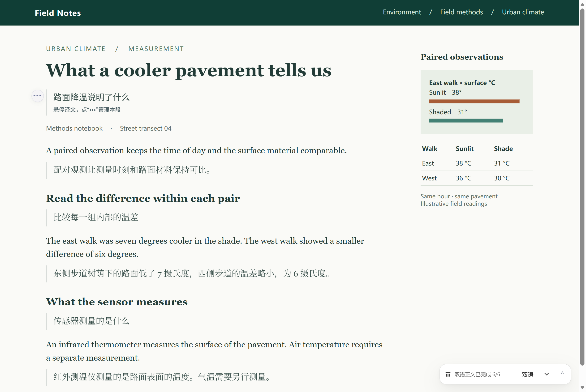

**读 PDF 时，把理解记在原句上。** 在 Pi 阅读器中开启批注，选中 “Shade lowered surface temperatures at noon.”，点击「高亮 / 笔记」。这里记下“区分路面温度与气温”，再点「保存高亮」。笔记连同原句和页码保存在本机，做这一步无需调用翻译服务。

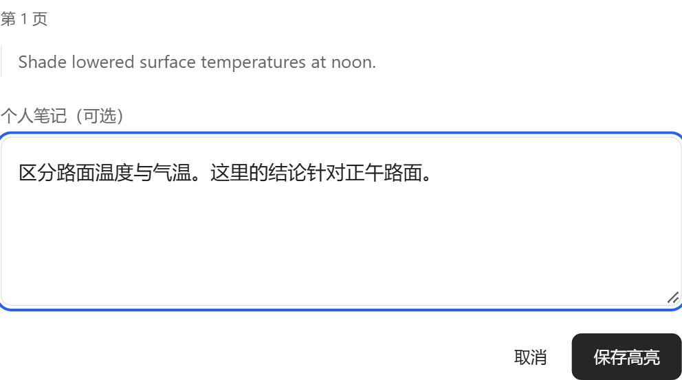

**下次只记得自己的用词，也能找到出处。** 在文档库输入“路面温度”，打开匹配项即可看到个人笔记、英文原句和第 1 页的来源。点击详情里的「定位原 PDF」，这次直接回到了已打开的论文。

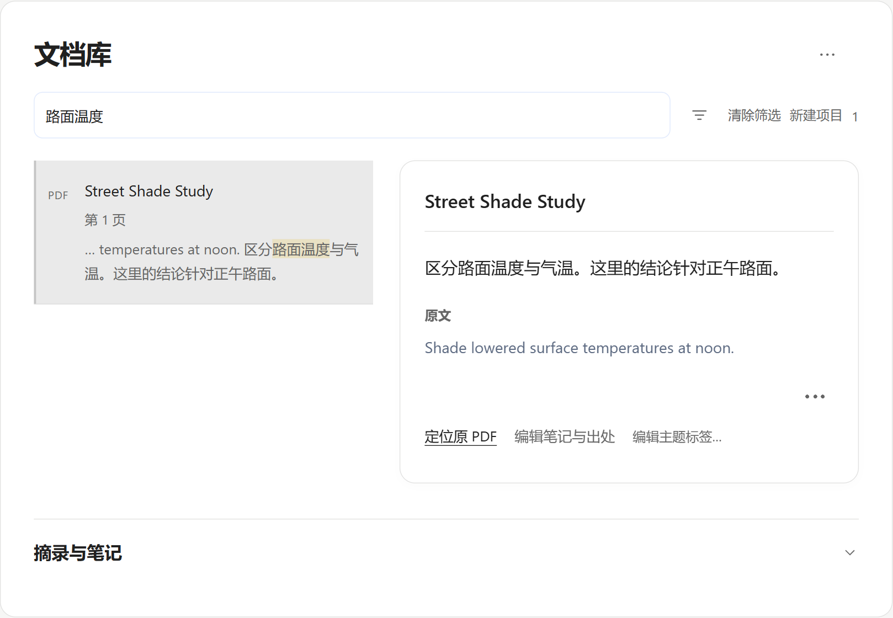

<details>
<summary>查看定位后的原文</summary>

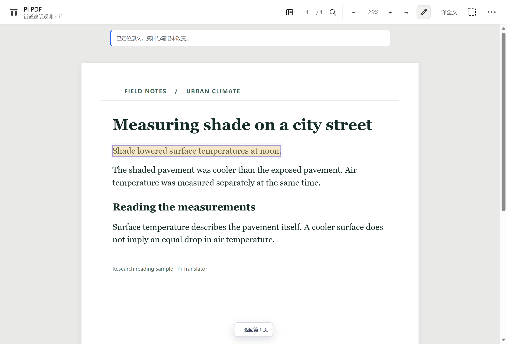

如果原件已经关闭，可使用在本机保留的原 PDF 副本，或按提示重新选择原文件。

</details>

以上界面均由实际扩展操作截取。示例文章和笔记为演示材料，图中的译文由模拟接口提供。

## 科研阅读图解

下面的科研阅读截图使用同一份真实论文 PDF。Thivin Anandh、Divij Ghose 和 Sashikumaar Ganesan 于 2024 年在 *Journal of Open Source Software* 发表了 *FastVPINNs*，介绍如何用神经网络求解偏微分方程。可以下载原文，在 Pi 阅读器里跟着操作。[论文与 DOI](https://doi.org/10.21105/joss.06764) · [期刊原版 PDF](https://joss.theoj.org/papers/10.21105/joss.06764.pdf)

### 全文翻译中对照正文

打开 PDF，点工具栏的 **译全文**。Pi 会先在本机读取文字层。在「翻译范围」选「整篇文档」可以处理全部五页，也可以改选当前页或指定页码。想直接通读就点 **开始翻译**；想先核对译法就展开 **先试译一段**，选择段落，点 **试译本段**。

下图在全文翻译面板中指定了**第 3 页**并完成处理。原文高亮段落讨论了如何用少量代码训练 hp-VPINNs 求解 PDE（偏微分方程）。点右侧这段中文，左侧就会定位到对应英文，下方的模块图也仍在原页，方便边读边查。想连续读中文时，可切换到「阅读」视图。

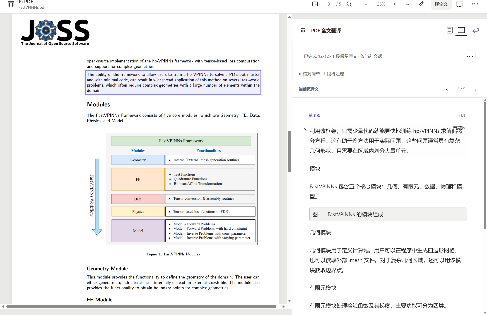

<details>
<summary>查看开始翻译前的范围设置</summary>

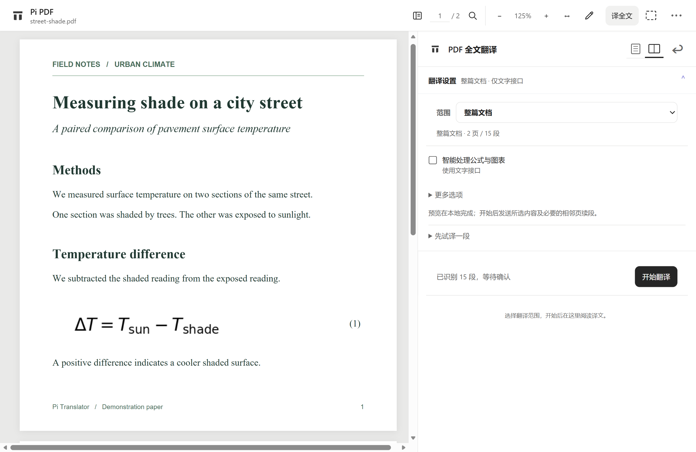

</details>

### 公式框选：把方程和边界条件一起读

回到第一页原文，点工具栏的**虚线方框**，拖选引言中的式（1）和式（2）。第一行给出泊松方程，第二行给出边界上的取值。像下图这样框住两行，并检查右侧的区域符号也在框内。拖动四角可调整范围，确认后点 **发送并翻译**。

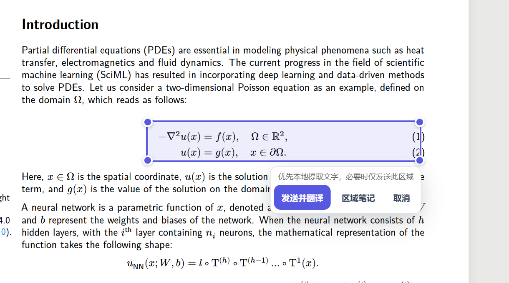

<details>
<summary>展开查看公式识别结果</summary>

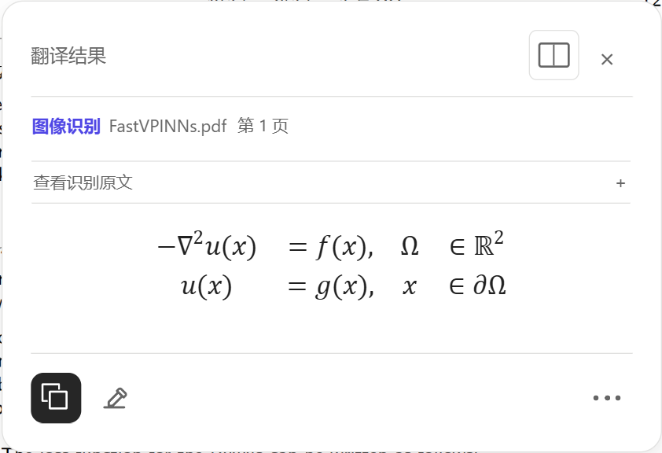

可点「查看识别原文」，回看负号、拉普拉斯算子的上标和第二行的边界符号 ∂Ω。需要图像识别时，请先配置支持图像输入的接口。

</details>

### 本文术语：为反复出现的词指定译法

论文标题和引言里都有 *partial differential equations*。若希望后续段落统一使用“偏微分方程”，打开全文翻译面板的 **··· → 检查术语 → 本文术语**。在「原文术语」填入英文，在「约定译法」填入中文，点 **保存词条**。表单下方会列出已确认的对应关系。

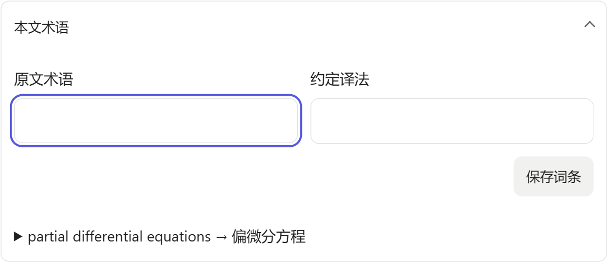

这个约定优先于通用词表，供本文后续翻译使用。已经读过的译段可以在「检查术语」中逐段核对，预览修改后再决定是否保存。

论文原页依 [CC BY 4.0](https://creativecommons.org/licenses/by/4.0/) 许可展示。截图包含 Pi 的面板与选框，其中公式局部作了裁切。示例段落的中文译文与公式识别结果由离线模拟接口提供。

## 快速上手

### 1. 安装并连接翻译服务

1. 在 [Microsoft Edge 扩展商店](https://microsoftedge.microsoft.com/addons/detail/edfkcddhenkhdkedhnmcebmmfacabcjf)安装 Pi Translator，点击浏览器工具栏中的扩展图标。
2. 在首次设置中按提示选择用途、翻译服务商并填写自己的 API Key；按浏览器提示授予所选接口所需的访问权限。可读取模型列表，也可手动填写模型 ID。
3. 先完成**文字翻译**即可开始使用。公式、图片和截图翻译需要时，再配置可处理图像的模型；这些增强设置可跳过。
4. 主动测试连接会发送示例请求，可能产生费用。普通保存设置不会自动测试模型。

扩展提供 DeepSeek、阿里云百炼 / Qwen、OpenAI、Anthropic、Google Gemini、OpenRouter 和本机 Ollama 等预设，也支持填写自定义兼容接口。预设和模型列表并不保证你的账号可使用所有模型，具体以服务商提供的能力和权限为准。

### 2. 翻译网页

在普通网页选中文字，点击出现的小翻译按钮；也可使用右键菜单或快捷键 `Alt+Shift+T`。首次在普通网页使用持续划词功能时，按提示决定是否授予网站访问权限。图标会根据选区和目标语言等条件决定是否显示，用户也可以暂停当前网站的自动划词。

**普通网页划词。** 阅读前面的观测文章时，选中讲解配对测量的一句，就能在选区旁查看“测量时刻和路面材料保持可比”的含义，同时参照右侧的测点表。

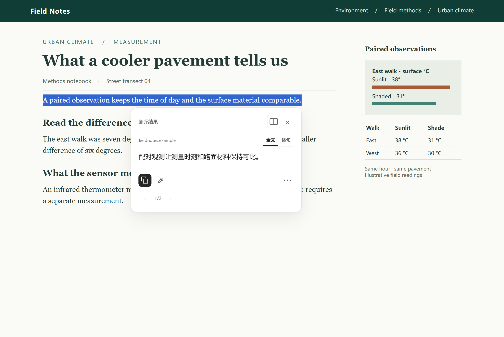

**Overleaf 文稿划词。** 在 `main.tex` 的测量方法段选中一句英文，卡片会解释作者如何为遮阴测点匹配日照测点。右侧编译稿展示同一份源码的摘要、温差方程和观测表格。

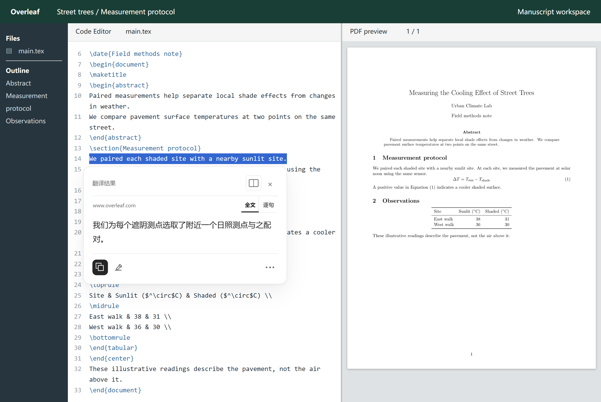

网页是含示例读数的离线文章，Overleaf 场景使用本地搭建的演示编辑器与实际编译的 PDF。两张图中的划词卡片均由 Pi Translator 显示，译文来自模拟接口。

想连续阅读时，可以使用页面侧栏或 Edge 浏览器侧栏；想阅读双语全文时，从扩展面板主动启动网页正文翻译。浏览器内部页面、扩展商店及其他禁止扩展访问的页面不支持网页划词。

### 3. 在 Pi 阅读器中打开 PDF

从扩展面板选择 **打开 PDF 阅读器**，然后选择本地文件；也可以从支持的在线 PDF 或 Edge 原生 PDF 侧栏进入。浏览器读取本地文件时，可能需要在扩展详情中允许访问文件 URL；也可以在 Pi 阅读器中手动选择文件。

有文字层的 PDF 可以直接划词。整篇对照、图片公式和文档专用词条的操作见[科研阅读图解](#科研阅读图解)。

## 功能介绍

### 划词、双语与侧栏

- 在网页、Overleaf 和 Pi PDF 中划选文字，查看原文与译文；支持逐句对照、复制和手动修正。
- 页面侧栏适合连续划词；浏览器侧栏可在 Edge 原生 PDF 等场景使用，并提供进入 Pi 阅读器的入口。
- 网页正文翻译在原文附近展示译文；可按需开始、暂停、继续或调整显示方式。
- 网页或 PDF 的区域框选适合图像、图表和复杂公式；发送前需要确认选定区域，并配置兼容的视觉模型。

### 阅读、笔记与资料库


在 Pi PDF 中搜索、标记、记笔记并返回出处；已保存的网页和 PDF 内容可在文档库中搜索、筛选和继续阅读。可用项目、标签组织资料，也可在阅读回顾中查看已有标记和最近修改的笔记。

本篇笔记小结会先展示可选范围，只有主动生成时才使用当前配置的文字接口。小结中的出处入口帮助你回到记录位置；生成内容仍需结合原文核对。

原 PDF 默认不会因为阅读而复制到资料库。你可以选择在本机保留原文件副本；导出备份时，也可以选择是否包含这些副本。备份与恢复的范围和限制以界面预览及[隐私政策](PRIVACY.md)为准。

### 用途、研究领域与术语


在 **翻译偏好** 中选择用途、语言和翻译方式；科研用户还可以填写研究领域。研究领域可在本机辅助推荐已有术语方案，只有确认后才会应用；也可选择让后续翻译参考该领域。启用该选项时，领域名称会随相关翻译请求发送给所选服务商。

术语方案适合维护某个领域常用的译法；**本文确认术语**用于当前文档并优先于通用约定。你可以导入、编辑和确认词条，人工修正与旧译文不会因选择方案而自动重写。

### 公式、图像与扫描件

文字翻译与图像增强可以使用不同配置。网页截图翻译、PDF 区域翻译及部分公式识别需要支持图像输入的模型；扫描页识别还有独立的 OCR 配置要求。设置页面会区分“已填写”和“已测试”，避免把模型列表当作能力验证。

公式、表格和复杂版面可能出现识别或翻译误差；请对照原文检查。已知 PDF 问题、验证范围与未解决事项记录在 [PDF 翻译问题台账](docs/pdf-translation-issues.md)。

## 隐私与数据

- 已保存的资料、笔记、阅读位置和术语主要保存在浏览器本机，可通过资料库管理和备份。
- 用户触发翻译、生成笔记小结或确认图像识别时，相应文本、选中的笔记或图像区域会发送至所配置的服务商；具体范围取决于所用功能。
- API Key 用于访问你配置的服务；请不要将真实 Key 提交到仓库、写入问题反馈或放在截图中。
- 原 PDF 副本是否保留、是否随备份导出由你选择。完整权限、数据保存范围和备份限制见 [隐私政策](PRIVACY.md)。

## 常见问题

**划词后没有出现按钮？** 检查是否已授权当前网站、是否暂停了该网站的自动划词，以及选区是否需要翻译。浏览器内部页面、扩展商店等受限页面无法注入扩展；也可尝试右键菜单或快捷键。

**已有文字 API，还要配置图像模型吗？** 普通文字翻译不需要。只有使用图片、截图、部分公式增强等功能时才需要兼容的视觉模型；扫描页 OCR 另有要求。

**设置完成后会自动翻译吗？** 普通保存设置不会自动测试模型。遇到中断任务时，按页面提示返回并确认相应操作；测试连接或主动翻译可能产生服务商费用。

**翻译和笔记可以备份吗？** 可以在文档库中预览、导出和导入支持的资料。API Key 不包含在安全配置导出中；原 PDF 副本是否进入资料库备份需在导出时主动选择。恢复前请阅读界面预览。

## 从源码运行

需要 Node.js 24 和 npm，版本要求见 [package.json](package.json)：

```bash
git clone https://github.com/LittlePyx/Pi-translator.git
cd Pi-translator
npm ci
npm run build:edge
```

在 Edge 打开 `edge://extensions`，开启开发人员模式，选择 **加载解压缩的扩展**，然后选择项目目录下的 `.output/edge-mv3`。更新源码并重新构建后，在扩展管理页重新加载扩展，再刷新已有网页。商店版和本地加载版是不同的安装途径；仓库代码可能包含尚未进入商店版本的改进。

## 开发与反馈

```bash
npm run typecheck          # 类型检查
npm test                   # 单元测试
npm run test:e2e           # 构建并运行浏览器测试
npm run check:secrets      # 检查常见密钥格式
```

浏览器测试需要本机 Microsoft Edge；测试说明见[验证报告](docs/verification-report.md)。更新记录见 [CHANGELOG](CHANGELOG.md)。遇到问题时，欢迎在 [Issues](https://github.com/LittlePyx/Pi-translator/issues) 描述操作步骤、预期和实际结果；请勿提交 API Key、私人文档或敏感截图。

由 P&I Lab 开发。
