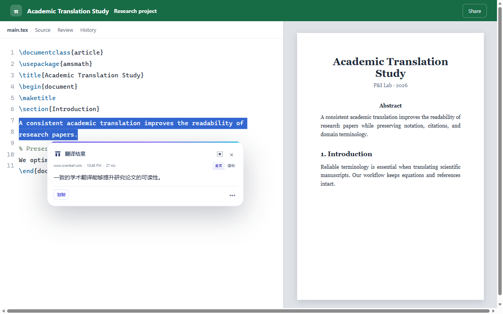

# Pi Translator（PI划词翻译器）

Pi Translator 是一款 Microsoft Edge 翻译扩展，帮助你在网页、Overleaf 和 PDF 中阅读外文内容。划选文字即可查看译文，也可以翻译网页正文、在 Pi 阅读器中阅读 PDF，或保存笔记与术语，方便下次继续。

[在 Edge 扩展商店安装](https://microsoftedge.microsoft.com/addons/detail/edfkcddhenkhdkedhnmcebmmfacabcjf) · [隐私政策](PRIVACY.md) · [更新日志](CHANGELOG.md) · [反馈问题](https://github.com/LittlePyx/Pi-translator/issues)



## 可以做什么

- **网页翻译**：划词查看译文，使用网页侧栏或浏览器侧栏连续阅读，也可以按需开启网页正文双语翻译。
- **PDF 阅读**：在 Pi 阅读器中划词、翻译全文、搜索和返回原文；支持笔记、标记与阅读位置。复杂排版或扫描件的识别结果需要人工核对。
- **资料与术语**：保存翻译、摘录与笔记，搜索并回到出处；维护术语方案和本文确认的译法。研究领域可在本机辅助推荐已有方案，需确认后应用。
- **公式与图像**：按需框选页面或 PDF 区域，使用兼容的图像模型辅助翻译；扫描页识别另有接口要求。
- **备份与恢复**：在资料库导出、预览和导入备份。原 PDF 副本是否包含在备份中由你选择。

## 开始使用

1. 从 [Microsoft Edge 扩展商店](https://microsoftedge.microsoft.com/addons/detail/edfkcddhenkhdkedhnmcebmmfacabcjf)安装并打开 Pi Translator。
2. 按首次设置提示选择翻译服务，填写自己的 API Key 和文字模型，并按浏览器提示授权所需的接口域名。你也可以稍后在设置中修改。
3. 在普通网页选择文字，使用出现的翻译按钮；也可通过扩展面板、右键或快捷键启动。首次在普通网页持续使用划词按钮时，按提示授予网站访问权限。
4. 阅读 PDF 时，从扩展面板打开 Pi 阅读器并选择文件；在 Edge 原生 PDF 侧栏中也可以进入 Pi 阅读器。

翻译服务由你自行选择和配置，服务商可能收取费用。首次设置可以先只配置文字翻译；需要框选图片或增强公式翻译时，再按提示配置支持图像的模型。模型测试会发送示例请求，普通保存设置不会自动测试。扫描页识别另需支持的 OCR 配置，不能仅凭文字模型或普通图像模型保证可用。

浏览器内部页面、扩展商店等限制扩展访问的页面不可使用网页划词功能。本地 PDF 可在 Pi 阅读器中手动选择；直接从浏览器打开本地文件可能需要在扩展详情中允许访问文件 URL。

## 数据与隐私

资料、阅读位置和用户确认的术语保存在浏览器本机；可通过资料库备份管理。翻译、主动生成小结或确认图像识别时，相应文本、已选笔记或图像区域会发送至你配置的服务商，具体取决于所使用的功能。服务商的数据处理和计费规则以其条款为准。

API Key 用于访问你配置的服务；不要把真实 Key 写入仓库或分享给他人。权限、数据保存范围和备份限制详见 [隐私政策](PRIVACY.md)。

## 从源码运行

需要 Node.js 24（版本要求见 [package.json](package.json)）和 npm：

```bash
npm ci
npm run build:edge
```

在 Edge 打开 `edge://extensions`，开启开发人员模式，选择“加载解压缩的扩展”，然后选择项目目录下的 `.output/edge-mv3`。更新源码并重新构建后，在扩展管理页重新加载扩展，再刷新已有网页。

仓库中的代码可能包含尚未进入商店版本的改进；安装商店版与本地加载源码版是不同的途径。

## 开发与反馈

```bash
npm run typecheck          # 类型检查
npm test                   # 单元测试
npm run test:e2e           # 构建并运行浏览器测试
npm run check:secrets      # 检查常见密钥格式
```

浏览器测试需要本机 Microsoft Edge；测试详情与可选场景见 [验证报告](docs/verification-report.md)。PDF 翻译问题和已知限制见 [问题台账](docs/pdf-translation-issues.md)。遇到问题时，欢迎在 [Issues](https://github.com/LittlePyx/Pi-translator/issues) 描述操作步骤、预期和实际结果；请勿提交 API Key、私人文档或敏感截图。

由 P&I Lab 开发。
